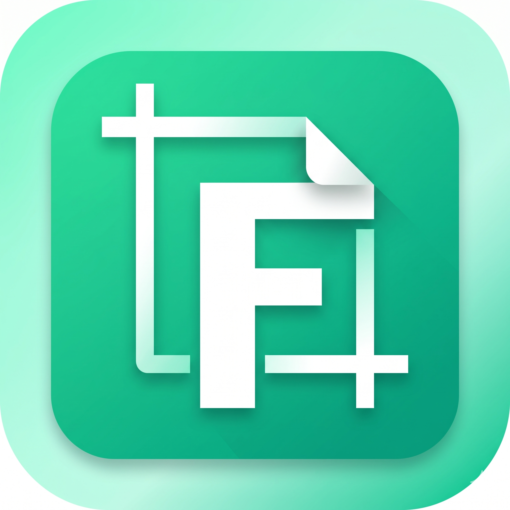

  

<h1 align="center">FormFix — Photo, Signature &amp; PDF Resizer PWA</h1>

  Fast, 100% client-side Progressive Web App to resize exam photos (20KB–50KB), signatures (10KB–20KB), 4×6 print sheets, and PDFs directly in your browser.

---

## ✨ Features
- **Exact KB Compression:** Resize photos and signatures to 10KB, 20KB, 50KB, 100KB, or 200KB locally.
- **Agniveer / SSC Slate:** Print Candidate Name and Date of Photo cleanly at the bottom.
- **4×6 Print Sheet (300 DPI):** Arrange 6 passport photos on a single printable sheet.
- **Image to PDF:** Convert documents and marksheets to compressed PDFs with zero server upload.
- **Format Converter:** Convert between JPG, PNG, and WebP offline.
- **PWA Ready:** Installable on Android and Desktop via `manifest.json` and `sw.js`.

## 👨‍💻 Author & Ecosystem
Built by **Rahul Mishra** ([GitHub](https://github.com/terarahul315))
- **IFSCPin:** https://ifscpin.pages.dev/
- **ReelSave:** https://reelsave-rouge.vercel.app/
